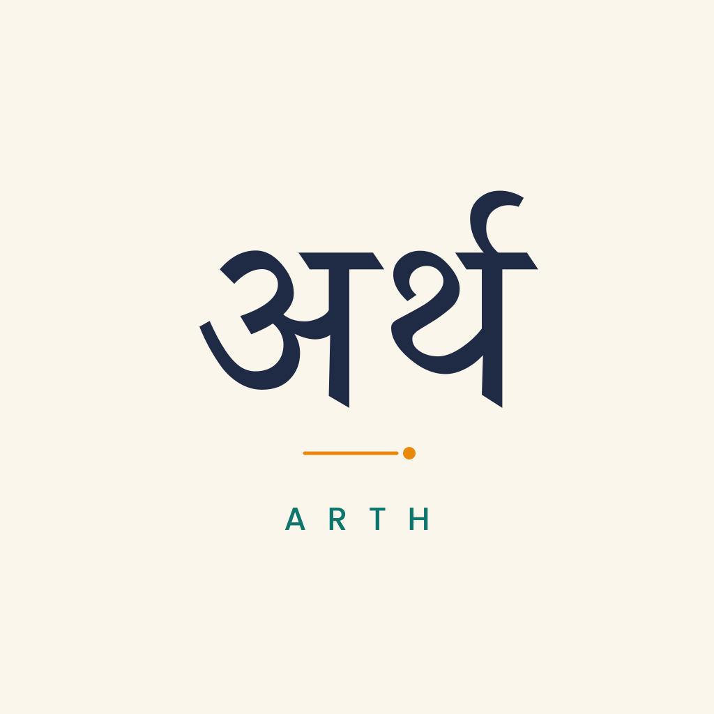
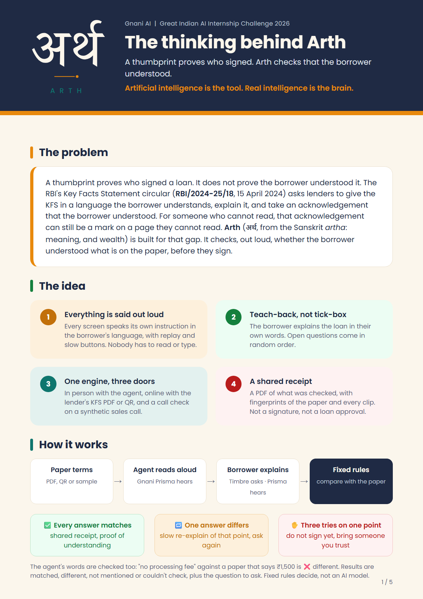
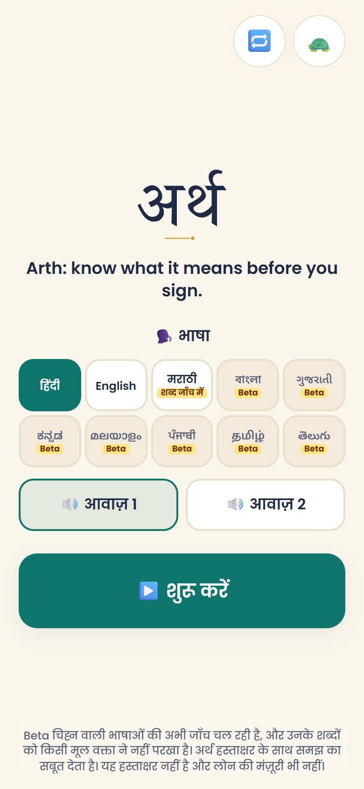
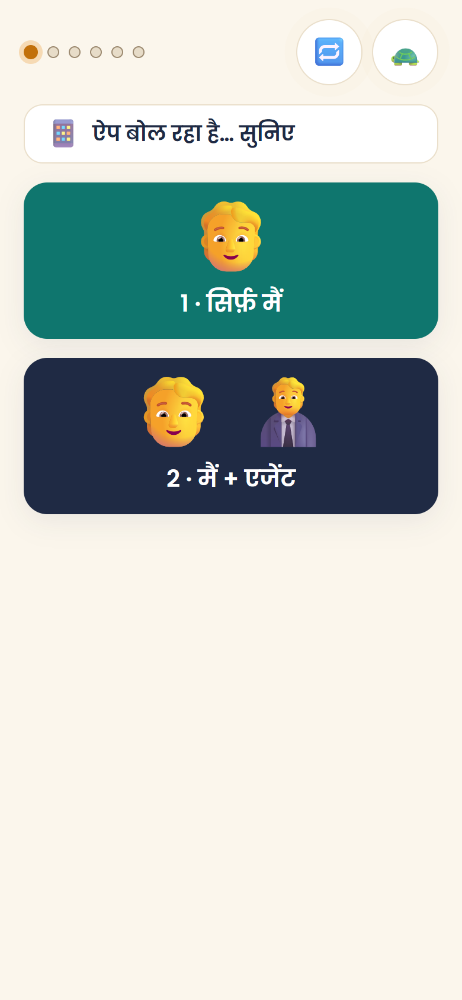
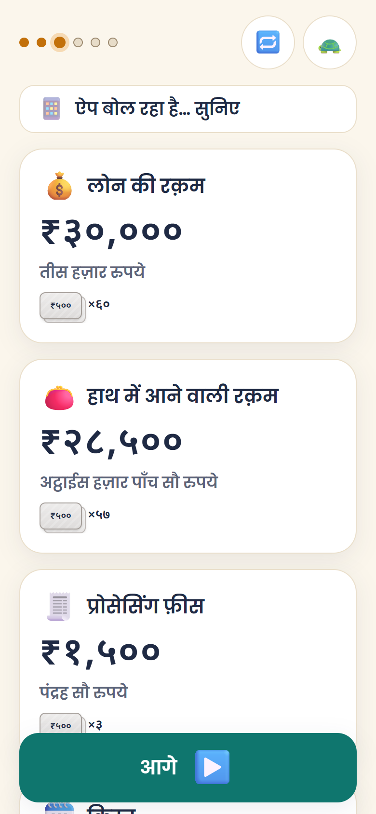
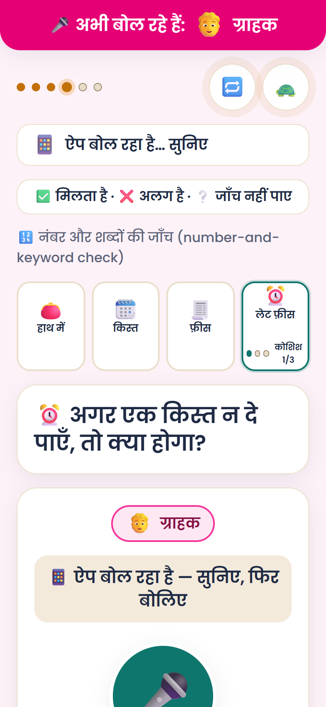

<p align="center">
  
</p>

<h1 align="center">Arth · अर्थ</h1>

<p align="center">
  <b>Know what it means before you sign.</b><br />
  A thumbprint proves who signed. Arth checks that the borrower understood.
</p>

<p align="center">
  <a href="Arth_Thinking_Behind_It.pdf"><b>📄 Read the thinking behind Arth (PDF)</b></a>
  &nbsp;·&nbsp;
  <a href="https://loanlens-mauve.vercel.app"><b>▶️ Try the live app</b></a>
  &nbsp;·&nbsp;
  <b>🎬 Walkthrough video:</b> link coming <!-- WALKTHROUGH_VIDEO_LINK: paste here -->
  &nbsp;·&nbsp;
  <a href="https://loanlens-mauve.vercel.app/sample/kfs-sahyog.pdf"><b>🧾 Sample loan paper (KFS PDF, fictional)</b></a>
</p>

> [!TIP]
> **📲 Install it from Chrome (recommended).** Arth works in the browser, but it works best installed on the phone like an app: it opens full screen with no address bar, starts from its own icon, and shows up in the phone's **Share** menu, so a lender's KFS PDF received on WhatsApp can be sent straight to Arth.
>
> **Android (Chrome):**
> 1. Open **https://loanlens-mauve.vercel.app** in Chrome.
> 2. Tap the **⋮** menu (top right).
> 3. Tap **Install app** (on some phones it says **Add to Home screen**), then **Install**.
> 4. Open **Arth** from the new icon on the home screen.
> 5. The first time you record, tap **Allow** when Chrome asks for the microphone.
>
> To send a KFS PDF to Arth: open the PDF (for example in WhatsApp), tap **Share**, and pick **Arth**.
>
> **🧾 Try it with the sample loan paper:** [download the sample KFS PDF](https://loanlens-mauve.vercel.app/sample/kfs-sahyog.pdf) (fictional lender "Sahyog Finance", fictional borrower). On the phone, share it to Arth as above. Or open it on a laptop screen and, in Arth, tap **📷 1 · QR** to scan the QR code printed on it.
>
> **iPhone (Safari):** open the link, tap **Share**, then **Add to Home Screen**. Sharing a PDF to Arth from other apps works only on Android.

<p align="center">
  <a href="Arth_Thinking_Behind_It.pdf"></a><br />
  <sub>Click the page to open the full 5-page PDF: the problem, the research, consent and privacy, the design choices, and what changed from plan to product.</sub>
</p>

> **Artificial intelligence is the tool. Real intelligence is the brain.**
> Arth, from the Sanskrit *artha*: meaning, and wealth. Built solo for the Gnani AI Great Indian AI Internship Challenge, using only Gnani AI models.

> Voice is **not** a legal signature. The receipt is **proof of understanding, alongside the signature**. It is not a signature, not a loan approval, and not a verdict on any lender.

## Try it in 60 seconds

1. Open **https://loanlens-mauve.vercel.app** on a phone (Chrome on Android works best), with the sound on.
2. Tap **→**, then **▶️ शुरू करें** (Start), then **1 · सिर्फ़ मैं** (only me).
3. Tap **🧪 3 · नमूना** (Sample) to load the built-in sample paper.
4. Follow the spoken instructions. Every screen speaks; 🔁 replays it and 🐢 plays it slower.

The sample paper is synthetic: a fictional lender ("Sahyog Finance (fictional)") and fictional terms.

## Screenshots

Real screens from the app on a phone-sized screen.

<p>
  
  
  
  
</p>

## How it works

**Three doors, one deterministic engine.**

- 🏠 **In person:** the agent records a spoken consent line, then reads the key terms aloud one by one. Each spoken term is compared with the paper. Then the borrower explains the loan back in their own words (teach-back): money in hand, instalment, fee, and what happens after a missed instalment. Questions come in random order. The check passes only when every answer matches the paper; after three different answers on one point the app says: do not sign yet, bring someone you trust.
- 📱 **Online:** the borrower shares the lender's Key Facts Statement (KFS) PDF, or scans a QR code on it, and gets the same explanation and teach-back.
- 📞 **Call check** (`/call`, synthetic sample only): a synthetic sales call is transcribed and its promises are compared with the paper.

Every result is one of **matched / different / not mentioned / couldn't check**, always shown as colour + icon + sound, together with the question to ask the lender and where to complain (the lender's grievance officer named on the KFS, then the RBI complaint portal, cms.rbi.org.in). The app never gives a verdict on a loan or a lender.

**No LLM decides anything.** Reading the paper, pulling numbers out of speech, comparing them and the teach-back check are all deterministic TypeScript rules with unit tests (`lib/engine/`). Unknown stays unknown; a missing value is never treated as 0. Only like-for-like fields (same unit and frequency) are compared; anything else is "couldn't check".

**Only Gnani AI models.**

| Role | Model | Where |
|---|---|---|
| Speech-to-text | **Gnani Prisma** (`prisma-v3.0`, `format=transcribe`, loan keyterms; v2.5 fallback) | `app/api/transcribe/route.ts` |
| Text-to-speech | **Gnani Timbre** (`timbre-v2.5`; Hindi Nalini / Deepak, English Kaveri / Pranav, Marathi Zahira / Ishaan) | `app/api/speak/route.ts` |

No other AI or ML model is used: no OCR, no third-party LLM, no browser speech recognition, no face or voice biometrics, no voice cloning. Ordinary non-AI libraries do the rest (`pdfjs-dist` for text-based PDFs, `jsqr` for QR codes, `pdf-lib` for the receipt).

The fixed prompts (welcome, instructions, the sample paper's explanation and the agent's check questions) were generated once with real Timbre calls and are stored in `public/audio`. A stored clip plays only when the exact text and voice match; everything else is spoken live through Timbre. All speech recognition is live Prisma.

## Languages

| Language | Status |
|---|---|
| Hindi | Stable |
| English | Stable |
| Marathi | Wording under review (shown with a review tag) |
| Bengali, Gujarati, Kannada, Malayalam, Punjabi, Tamil, Telugu | **Beta**: listed with a Beta tag, not selectable yet; wording not reviewed by a native speaker |

## Limitations

- Voice is not a legal signature, and the app does not prove whose voice it heard. Another person can speak for the borrower.
- The check covers only the listed fields (loan amount, amount in hand, instalment and how often, processing fee, tenure, late fee). Anything else on the paper is not checked.
- Accuracy has not been measured at scale. No accuracy figure is claimed.
- Beta languages may mislead: their wording has not been reviewed by a native speaker, which is why they cannot be selected yet.
- Synthetic data only: a fictional lender, fictional names, no real phone, account, Aadhaar or PAN numbers, and no real recorded calls.
- Speech-to-text can mishear digits. When a number is unclear or implausible, the app asks again instead of guessing.
- An agent and a borrower who work together to fool the check are out of scope.

## Notes on Gnani's APIs

What we ran into while building this project:

- **Prisma accepts at most 30 s of audio per request.** The app stops a clip at 28 s, and the call check splits a call into pieces of at most 28 s.
- **Prisma detects the audio format from the file name extension**, so the app always uploads the clip as `clip.wav`.
- **The browser's own recording format (WebM) is not accepted**, so the app records with the Web Audio API and encodes 16 kHz mono 16-bit WAV itself.
- **Prisma v3.0 with `format=transcribe` returns numbers as digits and keeps English loan words in Latin script.** Spoken "Aapko tees hazaar ka loan milega, EMI do hazaar chhe sau chhiyasath, aur processing fee nahi lagegi" came back as `आपको 30,000 का loan मिलेगा। EMI 2666 और processing fee नहीं लगेगी।` (kept as a test fixture).
- **Only one active request at a time.** Gnani can answer 429 when a second request overlaps, so every Prisma and Timbre call goes through one client-side queue, one at a time, with exponential backoff on Gnani's 429.
- **Timbre needs numbers written as spoken words** ("पंद्रह सौ रुपये", not "₹1,500"), so every spoken amount is converted to words first.
- **Static prompts are cached**: pre-generated clips for the fixed prompts, and an in-memory cache for anything already spoken in the session.

## Privacy and security

- Nothing is recorded in the background. Recording starts only on a tap and is always shown on screen (a red "recording" pill with a timer).
- The agent records a spoken consent line before anything about the loan is recorded.
- One big button clears everything from the session. There is no database and no login.
- `GNANI_API_KEY` is read only on the server (`lib/gnani/server.ts`), is never sent to the browser, and `.env*` is gitignored. Git history has been checked: the key was never committed. The API routes do not log audio, text or request bodies.
- The two API routes have a best-effort per-IP rate limit (60 requests per 5 minutes each), a 2 MB cap on uploaded audio and a 600-character cap on text to speak, and they accept only the models, voices and languages the app uses (`lib/gnani/allowed.ts`).
- Every page is served with security headers (no framing by other sites, no content-type sniffing, microphone and camera allowed for this site only). Developer test pages (`/smoke`, `/paper`) exist only under `npm run dev`.

## What's where

| Path | What it holds |
|---|---|
| [`Arth_Thinking_Behind_It.pdf`](Arth_Thinking_Behind_It.pdf) | The planning and design write-up (5 pages) |
| [`docs/PITCH.md`](docs/PITCH.md) | One-page pitch, as text |
| `docs/source/` | Source of the PDF; `node docs/source/build-pdf.mjs` rebuilds it and its README preview |
| `docs/screens/`, `docs/images/` | README screenshots and the PDF preview |
| `app/` | Next.js screens (`app/flow/`), the call check (`app/call/`) and the two API routes (`app/api/`) |
| `lib/engine/` | The deterministic rules: number parsing, claim extraction, comparison |
| `lib/paper/` | Reading the KFS from a PDF or QR |
| `lib/audio/` | Recording, WAV encoding, playback, stored prompts |
| `lib/gnani/` | Server-side Gnani access, the request queue and the allowed settings |
| `lib/i18n/` | Language packs (Hindi, English, Marathi, Beta languages) |
| `lib/receipt/` | The shareable PDF receipt and SHA-256 fingerprints |
| `tests/` | Unit tests (vitest) |
| `scripts/`, `eval/` | Clip generators and the evaluation runner |
| `public/` | Icons, stored Timbre prompts (`public/audio`), the sample KFS and sample call |
| `brand/` | Logo sources |

## Run locally

```bash
npm install
# create .env.local in the project root with your key:
# GNANI_API_KEY=your_key_here
npm run dev
npm test
npm run build
```

## Tests

`npm test` runs **553 tests** (31 files, all passing at the time of writing): number parsing in Hindi, Hinglish and Devanagari words, the fee conflict (₹1,500 vs "nahi"), missing values staying "not mentioned", weekly vs monthly as "couldn't check", the teach-back check, paper reading, the receipt, the request queue, and the API route limits and allowed settings.

## Eval

`npm run eval -- --server <url>` sends your own recorded synthetic clips (kept locally in `eval/clips`, never committed) through the live Prisma endpoint, scores them with the engine and writes a report to `eval/out`. It needs a running server with a Gnani API key and spends one Prisma call per new clip.

Latest result: **[eval result to be added]** <!-- EVAL_RESULT: paste the real one-line summary from `npm run eval` here -->

## Tech

Next.js (App Router), TypeScript, Tailwind CSS, vitest, `pdfjs-dist`, `jsqr`, `pdf-lib`, Web Audio API (recording and playback), Web Crypto (SHA-256 fingerprints), Poppins and Noto Sans fonts. Deployed on Vercel.
